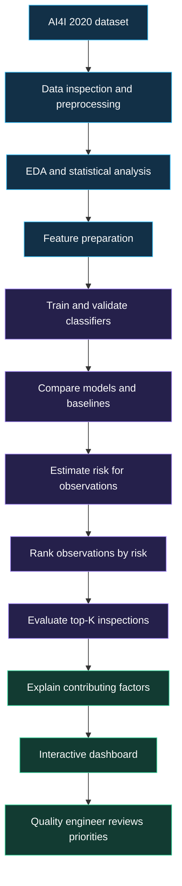

# 🏭 Production Line Quality Risk Advisor

**From machine-failure prediction to smarter inspection decisions.**

   

> **Project idea:** Help manufacturing quality engineers decide **which production observations to inspect first** when inspection time and resources are limited.

---

## 🧭 Quick navigation

- [🎯 Project overview](#-project-overview)
- [⚠️ The problem](#️-the-problem)
- [💡 Proposed solution](#-proposed-solution)
- [🔄 Interactive workflow diagram](#-interactive-workflow-diagram)
- [🧠 Machine-learning approach](#-machine-learning-approach)
- [📊 Why Precision@K matters](#-why-precisionk-matters)
- [🗂️ Dataset](#️-dataset)
- [🛠️ Technology stack](#️-technology-stack)
- [📈 Dashboard ideas](#-dashboard-ideas)
- [✨ What makes this project different?](#-what-makes-this-project-different)
- [🚀 Setup and usage](#-setup-and-usage)
- [✅ Development checklist](#-development-checklist)
- [⚖️ Scope and limitations](#️-scope-and-limitations)
- [🔮 Future improvements](#-future-improvements)

---

## 🎯 Project overview

**Production Line Quality Risk Advisor** is a machine-learning-based decision-support prototype for manufacturing quality teams.

It uses production parameters such as temperature, rotational speed, torque, product type, and tool wear to study patterns associated with machine failure. Rather than stopping at a simple *failure / no-failure* prediction, the project aims to rank observations by risk and help users prioritize a limited number of inspections.

### At a glance

| Area | Project focus |
|---|---|
| Problem type | Binary classification and inspection prioritization |
| Dataset | AI4I 2020 Predictive Maintenance Dataset |
| Main output | Risk-ranked production observations |
| Decision metric | Precision@K, where **K** is inspection capacity |
| Explainability | Feature importance and, if implemented, SHAP |
| User interface | Planned interactive dashboard |
| Intended user | Manufacturing quality engineer |

## ⚠️ The problem

A production line can generate many observations, but a quality team may not have the time or resources to inspect every item in detail.

A conventional classifier may predict whether an observation belongs to the failure class. That prediction alone does not fully answer the practical question:

**“If we can inspect only K observations, which ones should we inspect first?”**

This project explores how risk ranking, model evaluation, statistical analysis, and visual explanations can help answer that question.

## 💡 Proposed solution

The planned system brings together five steps:

1. **Understand the data** with exploratory data analysis and statistical summaries.
2. **Prepare usable features** while checking missing values, data types, outliers, and possible leakage.
3. **Train and compare classifiers** using suitable validation and classification metrics.
4. **Rank observations** by the model's estimated failure risk and evaluate the top-K list.
5. **Present evidence** in a dashboard so users can explore risk patterns and contributing factors.

> **Important:** The risk controls and demo values in a front-end mock-up are illustrative. They are not predictions from a trained model unless they are explicitly connected to the implemented pipeline.

## 🔄 Interactive workflow diagram

The diagram below is rendered by GitHub when viewed in a Markdown file that supports Mermaid.



## 🧠 Machine-learning approach

Candidate models to investigate:

| Model | Why consider it? |
|---|---|
| Logistic Regression | Interpretable baseline; supports regularization |
| Decision Tree | Easy-to-explain decision rules |
| Random Forest | Ensemble of trees that can model nonlinear patterns |
| AdaBoost | Boosting approach for combining weak learners |
| Support Vector Machine (SVM) | Alternative classifier for comparison |

The final model should be selected from **measured validation results**, not assumed in advance to be the best.

### Evaluation plan

- Use a train/test split and/or cross-validation appropriately.
- Inspect the confusion matrix.
- Report precision, recall, F1-score, and relevant class-wise results.
- Compare with simple baselines.
- Evaluate whether high-risk observations are actually concentrated near the top of the ranked list.
- Document limitations and avoid relying on accuracy alone.

### ⚠️ Prevent target leakage

The AI4I dataset contains failure-mode indicators such as `TWF`, `HDF`, `PWF`, `OSF`, and `RNF`, along with the overall machine-failure target. These indicators describe failure modes and should **not automatically be used as ordinary predictors** when the goal is to predict failure from operating conditions. Including target-related information can make evaluation misleading.

## 📊 Why Precision@K matters

**Precision@K** measures the fraction of the top **K** ranked observations that are actual positive cases.

\[
\mathrm{Precision@K} =
\frac{\text{Actual positive cases among the top K}}{K}
\]

### Example

Suppose a quality engineer can inspect **25 observations**, and **18** of those top-ranked observations are actual failure cases:

\[
\mathrm{Precision@25} = \frac{18}{25} = 0.72 = 72\%
\]

That means 72% of the selected top 25 observations were positive cases in this example. It does **not** mean the model has 72% accuracy overall.

Why this matters: the AI4I 2020 dataset is imbalanced, with far fewer failure cases than non-failure cases. A model can show high accuracy by mostly predicting the majority class while still missing the cases the team cares about. Precision@K complements standard classification metrics by reflecting the inspection-capacity constraint.

## 🗂️ Dataset

**AI4I 2020 Predictive Maintenance Dataset** from the UCI Machine Learning Repository.

- **Rows:** 10,000 observations
- **Task:** Machine-failure classification
- **Example input features:** product type, air temperature, process temperature, rotational speed, torque, and tool wear
- **Target:** machine failure

The dataset is synthetic and designed for predictive-maintenance research. Results on it should not be presented as proof of performance on a real factory line.

Dataset reference: [UCI Machine Learning Repository — AI4I 2020 Predictive Maintenance Dataset](https://archive.ics.uci.edu/dataset/601/ai4i+2020+predictive+maintenance+dataset)

## 🛠️ Technology stack

| Tool | Intended use |
|---|---|
| Python | Main programming language |
| pandas / NumPy | Data handling and numerical operations |
| scikit-learn | Preprocessing, model training, validation, and metrics |
| Matplotlib / Seaborn | Exploratory and statistical visualizations |
| Plotly | Interactive charts |
| Streamlit | Dashboard interface |
| SHAP | Model explanations, if integrated |

Only list a library as **implemented** once it is actually used in the repository.

## 📈 Dashboard ideas

The dashboard can be organized around practical questions:

- **Risk overview:** How many observations are marked high, medium, or lower risk?
- **Inspection queue:** Which observations are in the top-K list?
- **Capacity control:** How does the selected inspection capacity change the queue?
- **Operating patterns:** How do temperature, speed, torque, and tool wear vary across outcomes?
- **Model comparison:** How do candidate models compare on recall, precision, F1, and Precision@K?
- **Explanation view:** Which features influence a selected prediction? Add SHAP only after it is implemented and validated.

## ✨ What makes this project different?

The project’s contribution is the **decision-support workflow**, not a claim that it invents a new machine-learning algorithm.

| Conventional prediction workflow | Proposed advisor workflow |
|---|---|
| Predict failure / no failure | Rank observations by estimated risk |
| Emphasize general classification metrics | Also evaluate the top-K inspection list |
| Present a model result | Connect risk to an inspection-prioritization view |
| May provide limited context | Explore operating patterns and feature explanations |
| Output ends at prediction | Output supports a human review decision |

The key question becomes: **“Given our inspection capacity, how useful is the ranked list?”**

## 🚀 Setup and usage

These are starter commands for a Python project. Adjust filenames and dependencies to match the actual repository structure.

### 1. Clone the repository

```bash
git clone YOUR_REPOSITORY_URL
cd YOUR_PROJECT_FOLDER
```

### 2. Create and activate a virtual environment

```bash
python -m venv .venv
```

Windows PowerShell:

```powershell
.\.venv\Scripts\Activate.ps1
```

macOS / Linux:

```bash
source .venv/bin/activate
```

### 3. Install dependencies

If a `requirements.txt` file exists:

```bash
pip install -r requirements.txt
```

Otherwise, install only the libraries required by the implemented code, for example:

```bash
pip install pandas numpy scikit-learn matplotlib seaborn plotly streamlit
```

### 4. Run the project

Use the command matching the entry point you have actually created. For example, for a Streamlit app named `app.py`:

```bash
streamlit run app.py
```

> These commands are a setup template, not a claim that the repository already contains `app.py`, a trained model, or a complete dashboard.

## ✅ Development checklist

Use this checklist to track real progress. In GitHub Markdown, the boxes can be checked by editing the file.

- [ ] Add the dataset and document its source
- [ ] Inspect columns, types, missing values, duplicates, and class balance
- [ ] Complete EDA and statistical analysis
- [ ] Define leakage-aware predictor features and target
- [ ] Build a preprocessing pipeline
- [ ] Train baseline and candidate classification models
- [ ] Evaluate using cross-validation and class-sensitive metrics
- [ ] Implement risk ranking and Precision@K evaluation
- [ ] Add feature-importance explanations; validate SHAP if included
- [ ] Build the interactive dashboard
- [ ] Add tests and usage documentation
- [ ] Record measured results and known limitations

## ⚖️ Scope and limitations

- This is an academic prototype based on a synthetic dataset.
- Model quality must be reported using actual experimental results; no performance score is assumed here.
- The interactive concept demo is not a substitute for a trained model.
- The system is intended to support human inspection decisions. It does not control, shut down, or certify machinery.
- Real deployment would require representative plant data, domain-expert review, monitoring, and appropriate safety validation.

## 🔮 Future improvements

- Validate on real, appropriately governed manufacturing data.
- Add configurable inspection capacity and compare Precision@K across models.
- Add model calibration and decision-threshold analysis.
- Add explainability for individual observations and overall model behavior.
- Track model drift and retraining needs.
- Add exportable inspection queues and audit-friendly decision records.

---

## 🤝 Project status

This README describes the intended design and development plan. Update the checklist, technology stack, screenshots, and evaluation results as each feature is implemented and verified.

**Built as an academic project exploring machine learning, statistics, data visualization, and software engineering.**
